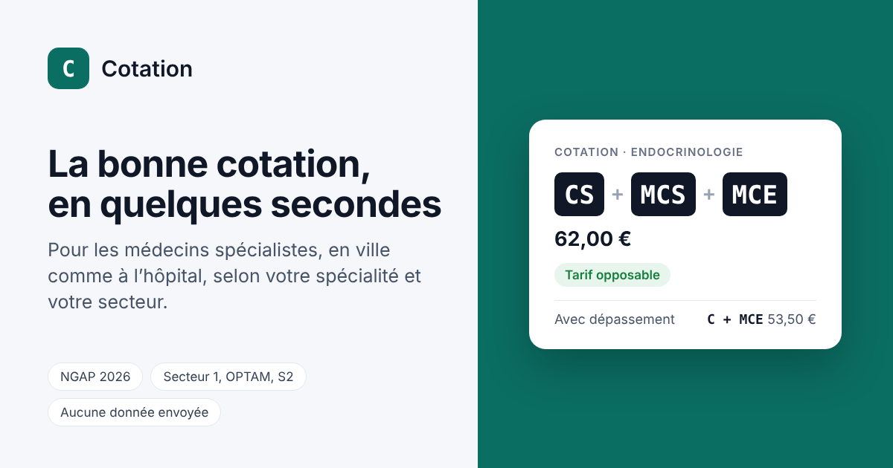

# Cotation

**La bonne cotation NGAP, en quelques secondes.** Pour les médecins spécialistes, en ville comme à l’hôpital, selon votre spécialité et votre secteur.

👉 **https://baptistemazas-nutrition.github.io/cotation/**

## Ce que fait l’outil

- Vous collez la fiche du patient (Doctolib, ORBIS, courrier d’adressage) ou vous répondez à quelques questions : motif, adressage, âge, couverture, téléconsultation, acte associé.
- Il donne les codes à saisir (par exemple `CS + MCS + MCE`), le montant de base, le mode de facturation (tarif opposable ou dépassement), ce qu’il faut faire pour être en règle (courrier au médecin traitant, devis…) et les pièges à éviter.
- Il explique chaque cotation : pourquoi un avis ponctuel (`APC`, `APY`) est possible ou non, quand la `MCS`, la `MCU` ou la `MCE` s’appliquent, quels actes se cumulent avec la consultation.

## Couverture

- **Spécialités** : cardiologie, chirurgie, dermatologie, endocrinologie-diabétologie-nutrition, gastro-entérologie, gériatrie, gynécologie médicale et obstétrique, hématologie-oncologie, médecine interne, MPR, néphrologie, neurologie, ophtalmologie, ORL, pneumologie, psychiatrie, rhumatologie, et autres spécialités médicales.
- **Secteurs** : secteur 1 et hôpital (tarif opposable, `APU` pour les PU-PH), secteur 2 OPTAM (dépassement maîtrisé), secteur 2 non OPTAM.
- **Pas encore couverts** : médecine générale, pédiatrie, professions de santé non médicales ; calcul de la MOP, des consultations complexes et de certaines majorations propres à une spécialité (signalées dans « Bon à savoir »).

## Utilisation

1. Choisissez votre spécialité et votre secteur dans « Mon exercice » (mémorisé sur votre appareil).
2. Collez la fiche du patient avec Ctrl+V n’importe où dans la page, ou répondez aux questions.
3. Copiez les codes.

**Sur Doctolib**, un favori à glisser dans la barre du navigateur ouvre l’outil par-dessus la fiche du rendez-vous et le pré-remplit (onglet « Doctolib et partage »). **Depuis ORBIS** ou un autre logiciel, utilisez le copier-coller.

**Hors ligne** : le fichier `index.html` fonctionne seul, d’un double-clic, sans connexion.

## Confidentialité

Tout se passe dans votre navigateur : aucune donnée saisie n’est envoyée, aucun compte, aucun cookie, aucune mesure d’audience. Seules les polices de caractères sont chargées depuis Google Fonts.

## Sources

- [Tarifs conventionnels des médecins, ameli.fr](https://www.ameli.fr/medecin/exercice-liberal/facturation-remuneration/consultations-actes/tarifs/tarifs-conventionnels-medecins-generalistes-specialistes)
- [Annexe 1 : cotations par spécialité au 1er janvier 2026](https://circulaires.ameli.fr/sites/default/files/directives/CIR-DDGOS-Convention%20M%C3%A9dicale%20Annexe-1.pdf)
- [Annexe 2 : calendrier des revalorisations](https://circulaires.ameli.fr/sites/default/files/directives/CIR-DDGOS-Conv.%20M%C3%A9d.%202024_Calendrier%20nomenclature-annexe%202.pdf)
- [Annexe 3 : actes CCAM cumulables avec la consultation](https://circulaires.ameli.fr/sites/default/files/directives/CIR-DDGOS-Convention%20M%C3%A9dicale%20Annexe-3.pdf)
- [Circulaire CIR-14/2025](https://circulaires.ameli.fr/sites/default/files/directives/cir/2025/CIR-14-2025.pdf)
- [NGAP au 1er janvier 2026](https://www.syngof.fr/wp-content/uploads/2026/01/NGAP-01012026.pdf)

## Avertissement

Aide à la décision, pas un avis juridique : la NGAP en vigueur sur ameli.fr et la CPAM font foi. Règles vérifiées en novembre 2026.

Une erreur, une spécialité à ajouter ? [Ouvrez un ticket](https://github.com/baptistemazas-nutrition/cotation/issues).

Conçu par le Dr Baptiste Mazas, endocrinologie, diabétologie et nutrition.
